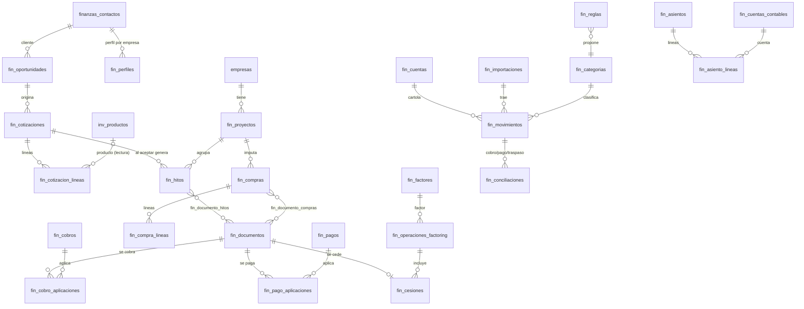

# Gestión financiera · Modelo de datos

Migración: `supabase/fin/0001_gestion_financiera.sql` (solo aditiva). 36 tablas `fin_*`, todas con
`empresa_id` (salvo las de aplicación/detalle, que heredan la empresa de su cabecera) y RLS
activado sin políticas. Los saldos, etapas y pasos **no se guardan**: se calculan al leer
(ver REGLAS.md).

## Diagrama principal

## Tablas por área

| Área | Tablas | Notas |
|---|---|---|
| Configuración | `fin_parametros` (uno por empresa: IVA, tolerancia, plazos, mínimo de caja, mora, horizonte, `flags`), `fin_cuentas` (banco/tarjeta/caja con saldo según banco), `fin_factores`, `fin_categorias`, `fin_reglas`, `fin_perfiles`, `fin_secuencias` + función `fin_siguiente_numero` | Catálogos sembrados para las tres empresas |
| Proyectos | `fin_proyectos` | Uno «General» (`PRY-0000`, `es_general`) por empresa para gastos sin proyecto |
| Comercial | `fin_oportunidades`, `fin_actividades` (bitácora de oportunidades, hitos y documentos), `fin_cotizaciones` (versionadas con `padre_id`), `fin_cotizacion_lineas` | |
| Ventas | `fin_hitos` (unidad facturable: EDP, hito, mes de arriendo, spot), `fin_documentos` (emitidos y recibidos; único por empresa + dirección + tipo + folio + RUT), `fin_documento_hitos`, `fin_cobros`, `fin_cobro_aplicaciones` | NC y ND referencian su factura con `documento_referenciado_id` |
| Compras | `fin_compras` (solicitud + aprobación + visado + OC + recepción), `fin_compra_lineas`, `fin_documento_compras`, `fin_pagos`, `fin_pago_aplicaciones` | La OC vive en la compra (DECISIONES D3) |
| Tesorería | `fin_importaciones`, `fin_movimientos` (único por empresa + huella), `fin_conciliaciones`, `fin_flujo_partidas` (montos manuales del flujo por mes y concepto) | |
| Factoring | `fin_operaciones_factoring`, `fin_cesiones` (una fila por factura cedida) | |
| Contabilidad | `fin_cuentas_contables` (plantilla PyME), `fin_periodos`, `fin_asientos` (con `origen_tipo` y `origen_id`), `fin_asiento_lineas` | |
| Transversal | `fin_adjuntos` (bucket privado `finanzas`), `fin_auditoria` (quién, qué, antes/después, motivo), `fin_eventos`, `fin_rutinas` (marcas del checklist por período) | |

## Lo que se toca fuera de `fin_*`

- `storage.buckets`: bucket privado `finanzas` (`on conflict do nothing`).
- `aplicaciones`: la fila «Gestión financiera» (`where not exists`).
- Ninguna otra tabla se modifica. Se referencian (FK) `empresas`, `finanzas_contactos` e `inv_productos`.
